<div align="center">

<a href="https://bidhata.github.io/untangled/"><picture><source media="(prefers-color-scheme: dark)" srcset="site/logo-dark.svg"></picture></a>

### Your router, untangled.

**A modern, friendly web interface for OpenWRT.** The power of LuCI — without the maze.<br>
Built for the whole household, with every advanced knob still one click away.

[](https://bidhata.github.io/untangled/)
[](https://bidhata.github.io/untangled/demo/)


<a href="https://bidhata.github.io/untangled/demo/">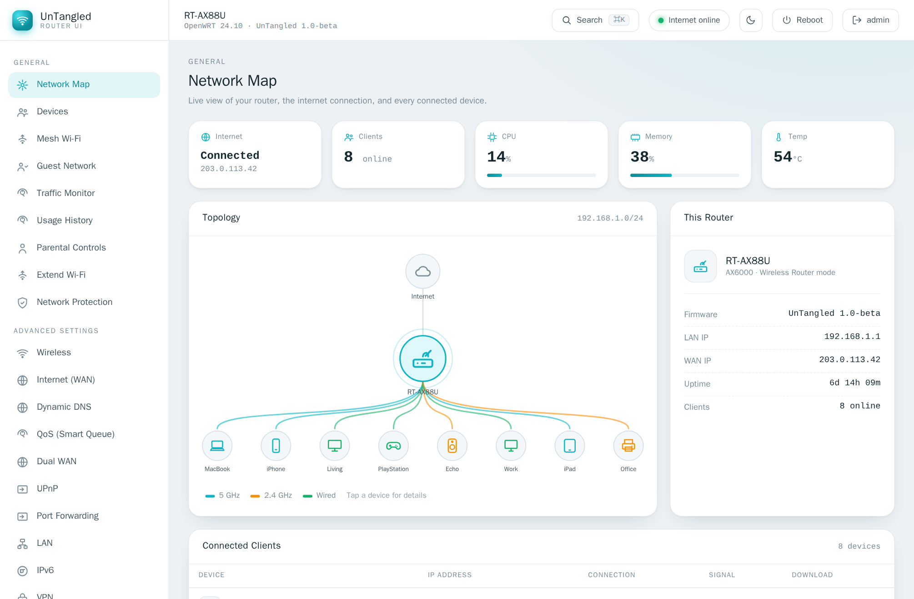</a>

</div>

---

OpenWRT is the best router firmware there is. Its stock interface was built for engineers. **UnTangled keeps all the power and makes it feel like a product** — a visual Network Map, plain-language controls and a `?` beside every setting for the family; a ⌘K command palette and "Advanced details" for you. It runs **alongside LuCI**, never replacing it.

## Install in 60 seconds

Add the signed UnTangled feed once, then install and upgrade with the router's own package manager. Run on the router (SSH, or LuCI → System → Custom Commands):

```sh
# Stable OpenWRT (23.05 / 24.10) — opkg
wget -O /tmp/untangled.pub https://bidhata.github.io/untangled/keys/untangled.pub && opkg-key add /tmp/untangled.pub
echo 'src/gz untangled https://bidhata.github.io/untangled/stable' >> /etc/opkg/customfeeds.conf
opkg update && opkg install untangled-full
```

```sh
# OpenWRT snapshot — apk
wget -O /etc/apk/keys/untangled.pem https://bidhata.github.io/untangled/keys/untangled.pem
echo 'https://bidhata.github.io/untangled/snapshot/packages.adb' > /etc/apk/repositories.d/untangled.list
apk update && apk add untangled-full
```

Then open **`http://<router-ip>/untangled/`** and sign in with your router's admin account. LuCI keeps working untouched at `/`.

| Package | What you get |
|---|---|
| `untangled` | Core UI + `/ubus` + session auth. HTTP-only, minimal. |
| `untangled-full` | Core **+** HTTPS, Wi-Fi scan, firmware upgrade, Wake-on-LAN. |
| `untangled-mesh` | Mesh Wi-Fi backend (dawn roaming + umdns discovery). |

Prefer a file? Every release attaches raw `.ipk` (stable) and `.apk` (snapshot) on [Releases](https://github.com/bidhata/untangled/releases). The package is architecture-independent (`PKGARCH:=all`), so one `.ipk` covers every current stable release; apk is used only by OpenWRT snapshot. Post-install ACL notes, size table and HTTPS setup: [`openwrt/README.md`](openwrt/README.md).

> 🖱️ **No router handy?** [Click through the live demo](https://bidhata.github.io/untangled/demo/) — the full UI with sample data, in your browser.

---

## Why UnTangled?

- 🧭 **Made for everyone** — task-based flows and a visual Network Map for non-technical users; full depth, a command palette and "Advanced details" disclosures for the technical ones. One UI, no compromise.
- 🛟 **Impossible to lock yourself out** — connectivity-risky changes (Wireless, WAN, LAN, Firewall, DMZ) apply with an **auto-rollback timer**. If a change would cut you off, the router quietly reverts it.
- 🪶 **Tiny, fast, private** — the whole UI is ~75 KB gzipped versus LuCI's megabytes. System fonts, no CDNs, no telemetry, no cloud account. The router never needs the internet to serve it.
- ❓ **Help where you need it** — a `?` beside each setting explains it in a sentence. No jargon walls.
- 📶 **Mesh Wi-Fi, the easy way** — one Wi-Fi name across routers with seamless 802.11r/k/v roaming, set up like a consumer mesh system.
- 🎨 **Light & dark** — a clean light theme by default, a Merlin-style dark theme one click away.
- 🧩 **Extensible** — a LuCI-style runtime plugin system lets packages add whole screens without rebuilding the core.

## A look around

<table>
  <tr>
    <td width="50%">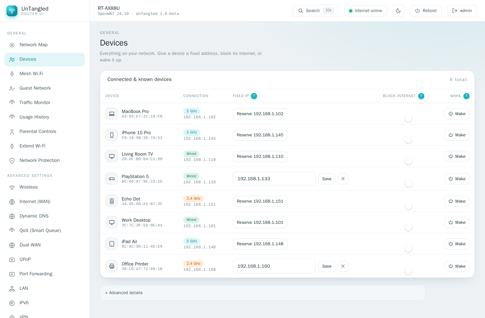<br><b>Devices</b> — reserve a fixed IP, block a device's internet, or wake it on LAN.</td>
    <td width="50%">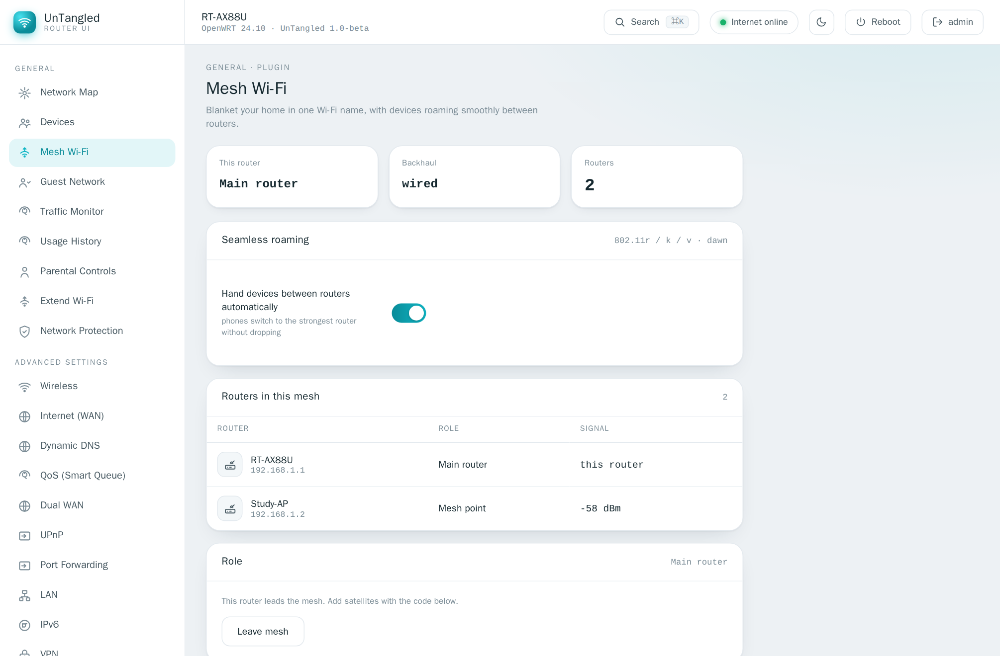<br><b>Mesh Wi-Fi</b> — one Wi-Fi name across routers with seamless roaming (a plugin).</td>
  </tr>
  <tr>
    <td width="50%">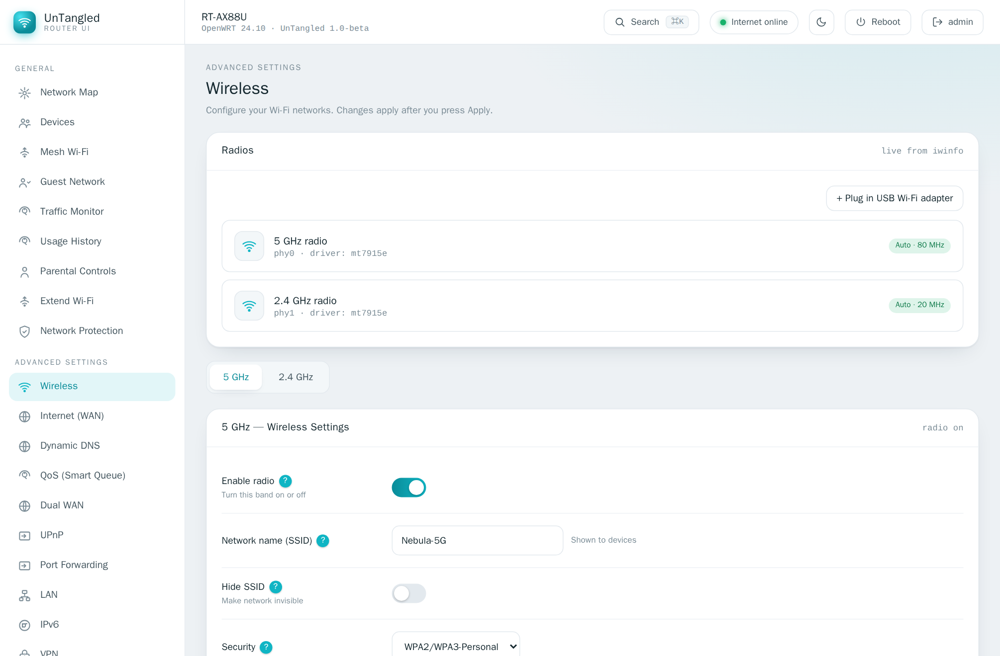<br><b>Wireless</b> — SSID, security and channels up front; power, fast-roaming and WMM under Advanced.</td>
    <td width="50%">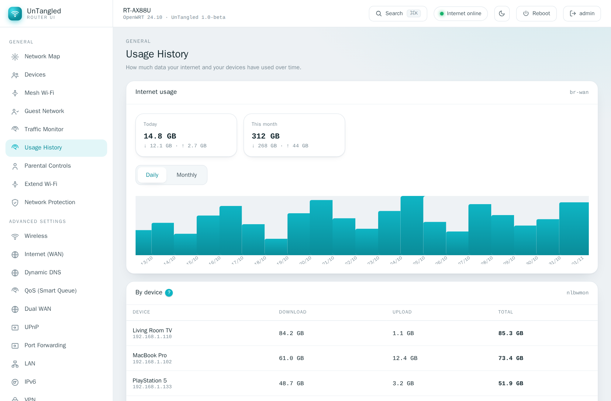<br><b>Usage History</b> — daily/monthly internet use and per-device totals.</td>
  </tr>
  <tr>
    <td width="50%">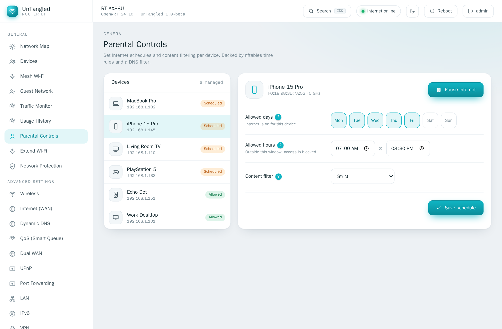<br><b>Parental Controls</b> — per-device internet schedules by the week.</td>
    <td width="50%">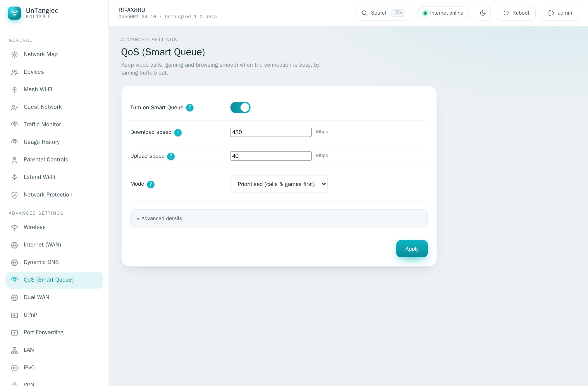<br><b>QoS (Smart Queue)</b> — kill bufferbloat; keep calls and gaming smooth.</td>
  </tr>
  <tr>
    <td width="50%">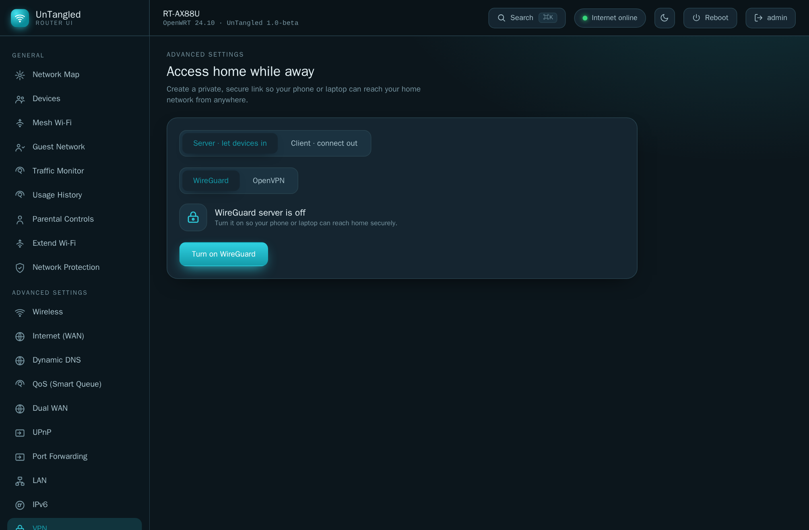<br><b>VPN</b> — WireGuard &amp; OpenVPN, server <em>and</em> client (dark theme).</td>
    <td width="50%">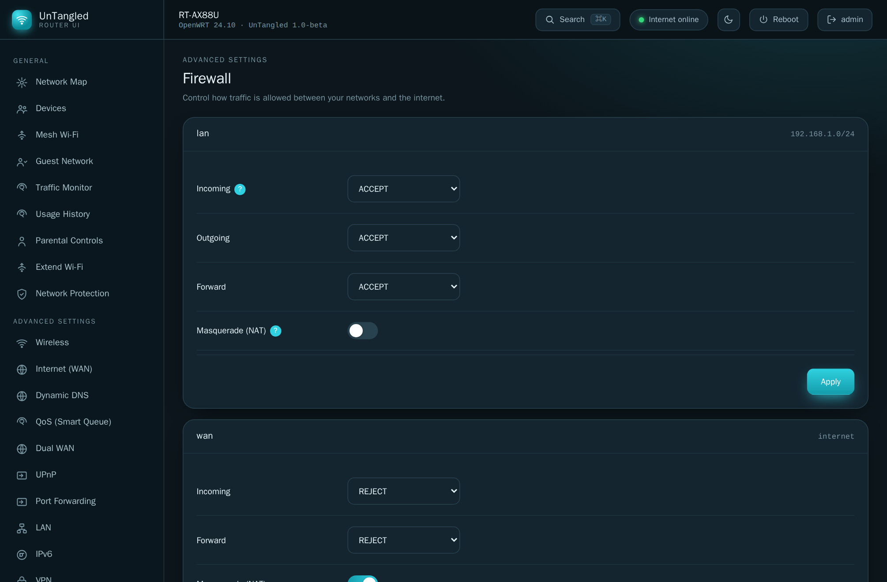<br><b>Firewall</b> — zone policies in plain terms, fw4/nftables under the hood (dark theme).</td>
  </tr>
  <tr>
    <td width="50%">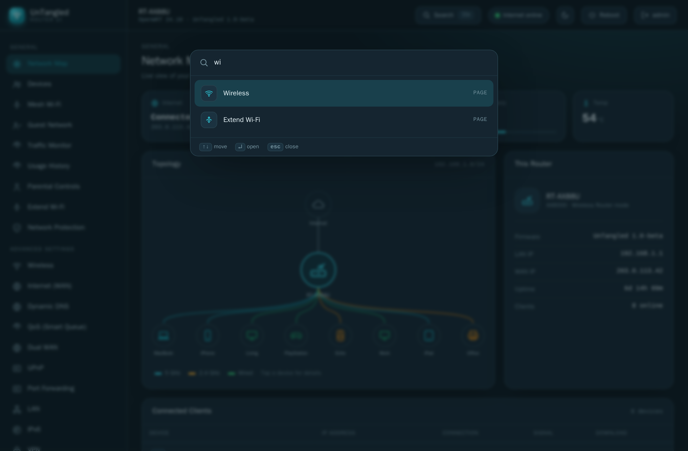<br><b>⌘K command palette</b> — jump to any page, device or action in a keystroke.</td>
    <td width="50%">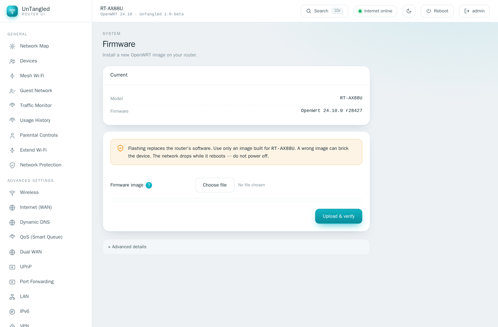<br><b>Firmware</b> — upload, verify, and flash a sysupgrade image, keeping your settings.</td>
  </tr>
</table>

**Everything in the box:** Network Map · Devices (fixed IP / block / Wake-on-LAN) · Mesh Wi-Fi · Guest Network · Traffic Monitor · Usage History · Parental Controls · Extend Wi-Fi (repeater) · Network Protection (ad/threat blocking) · Wireless (+ advanced radio tab) · Internet/WAN wizard · Dynamic DNS · QoS / Smart Queue · Dual WAN · UPnP · Port Forwarding · VPN (WireGuard + OpenVPN, server + client) · LAN · IPv6 · Firewall (zones) · DMZ · Administration (hostname, time, password, scheduled reboot, backup/restore) · System Log · USB Storage (SMB + DLNA) · Firmware upgrade · Software (apk/opkg).

Many advanced features light up only when their OpenWRT package is present and **degrade gracefully** — each shows an "install *package*" hint instead of an error when it isn't.

## UnTangled vs. LuCI

An honest comparison. LuCI is excellent and complete — UnTangled is the friendlier front door. Keep both.

| | UnTangled | LuCI |
|---|---|---|
| Built for non-technical users | ✅ task-based, plain language, per-field help | engineer-oriented |
| Visual Network Map & device cards | ✅ | — |
| Mesh Wi-Fi setup | ✅ guided, consumer-mesh style | manual, per package |
| Lock-out protection on risky changes | ✅ auto-rollback timer | apply-with-rollback (manual) |
| UI size | ✅ ~75 KB gzipped | several MB |
| Feature completeness & maturity | beta — growing fast | ✅ mature, exhaustive |
| Coexist on the same router | ✅ runs at `/untangled/`, never modifies LuCI | |

## How it works

UnTangled is *just the UI*. It reuses the OpenWRT backend you already have — **UCI + ubus + rpcd + uhttpd** — talking JSON-RPC to `/ubus` with the standard `session.login` and rpcd ACLs. Nothing runs as a separate daemon; nothing phones home.

```
src/
  lib/        ubus client, per-feature data layers (wireless, firewall, vpn, …)
  components/ Shell, Topbar, Sidebar, CommandPalette, Help, plugin host, …
  screens/    one Svelte component per nav item
public/plugins/  runtime plugins (e.g. Mesh Wi-Fi, Ping) + manifest
openwrt/    packaging: Makefile (3 packages), rpcd ACLs, uci-defaults
site/       the landing site + signed package feed (GitHub Pages)
ui-prototype/    the clickable UX prototype — also the live demo
```

## Develop

```sh
npm install
npm run dev                      # http://localhost:5173
ROUTER=192.168.1.1 npm run dev   # proxy /ubus to a real router for live data
npm run check                    # svelte-check / TypeScript
npm run build                    # -> dist/
```

**Stack:** Svelte 5 + Vite + TypeScript. Architecture, the per-screen data-source map and the plugin contract live in [`docs/ARCHITECTURE.md`](docs/ARCHITECTURE.md) and [`docs/PLUGINS.md`](docs/PLUGINS.md).

**Write a plugin:** a self-contained ES module dropped into `/www/untangled/plugins/` adds a nav entry and screen at runtime — no core rebuild — using a small stable API (`ubus`, `toast`, `navigate`, `getTheme`). See [`docs/PLUGINS.md`](docs/PLUGINS.md) and the examples in [`public/plugins/`](public/plugins/).

**Releases:** every `v*` tag builds `.ipk` (23.05 SDK) and `.apk` (snapshot SDK), signs them, attaches them to a GitHub Release and publishes the feed + this site to GitHub Pages. Maintainer notes on signing keys and one-time repo setup: [`keys/README.md`](keys/README.md).

## Status & roadmap

UnTangled is in **beta**. The code is written to documented OpenWRT UCI/ubus/fw4 interfaces, and every release is installed and exercised in real OpenWRT containers (23.05 and snapshot — install, dependencies, HTTP serving, `/ubus` auth, ACLs, mesh backend) before it ships. It has **not yet been validated on many physical routers** — that's where you come in.

Next up: hardware validation reports · VPN policy routing (per-device VPN, à la Merlin's VPN Director) · Mesh phase 3 (automatic node discovery, one-click dumb-AP bridging, 802.11s wireless backhaul).

## Help it grow

- ⭐ **Star the repo** — it's the single best way to help more OpenWRT users find a friendlier UI.
- 🧪 **Run it on your router** and [open an issue](https://github.com/bidhata/untangled/issues) with what you see — model, OpenWRT version, what worked, what didn't.
- 🧩 **Build a plugin** for the thing your network needs.
- 🗣️ Tell a friend who's been putting off OpenWRT because of the UI.

## Credits

Developed by **Krish Paul** · <me@krishnendu.com> · Licensed **GPL-2.0-or-later**<br>
Website: <https://bidhata.github.io/untangled/> · Source: <https://github.com/bidhata/untangled>

Thanks to **[@spdixit](https://github.com/spdixit)** for field testing and bug reports
(device band/connection detection, applied-item ordering, and installed-app visibility).
